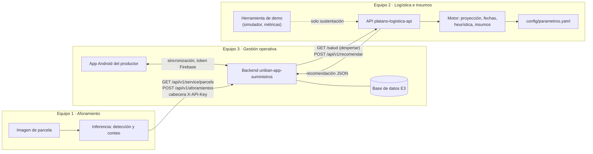
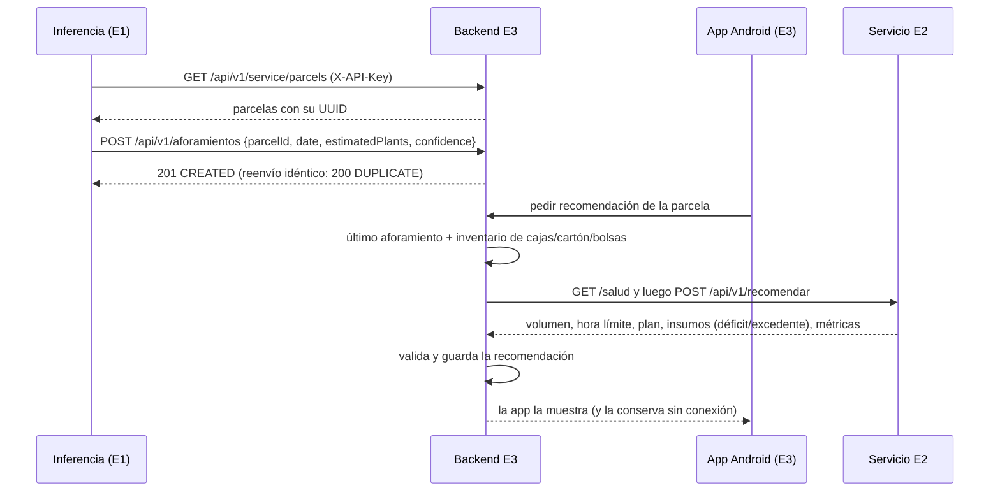

# Arquitectura de la solución integrada UNIBÁN

> **Estado:** propuesta del Equipo 2 (enlace: David Arango) para validar con los enlaces
> Juan José Monsalve (Equipo 3) y Andrés Felipe Flores (Equipo 1). Refleja lo que está
> desplegado y verificado el 28/10/2026; lo que no está verificado se marca como tal.

## Componentes y responsabilidades

| Componente | Equipo | Responsabilidad | Despliegue |
|---|---|---|---|
| Módulo de inferencia (visión artificial) | 1 | Detecta y cuenta plantas en imágenes de una parcela y genera el aforamiento | Lo define el Equipo 1 (no verificado por el Equipo 2) |
| App móvil Android | 3 | **Única interfaz del productor**: parcelas, ciclos, inventario sin conexión, aforamientos y recomendaciones | Dispositivo Android |
| Backend de gestión operativa | 3 | Fuente de verdad de productores, parcelas, inventario y aforamientos (D-008); hace de puente hacia el Equipo 2 | `uniban-app-suministros.onrender.com` |
| Servicio de logística e insumos | 2 | Proyecta la cosecha, calcula la hora límite de corte, programa el despacho y deriva los insumos | `platano-logistica-api.onrender.com` |
| Herramienta de demostración técnica | 2 | Simulador y comparación de modelos para la sustentación. **No** es una interfaz para el productor | App Expo (`frontend/`) y `scripts/` |

## Comunicaciones

## Secuencia de extremo a extremo (demo del 29/10)

## Evitar duplicidades (punto 4 del profesor)

- **Interfaz del productor:** solo la app del Equipo 3. El Equipo 2 no ofrece pantallas para el
  productor; la app Expo del Equipo 2 se presenta únicamente como herramienta técnica para
  demostrar el motor (simulador y métricas del modelo predictivo).
- **Datos maestros:** parcelas, productores, inventario y aforamientos viven en el Equipo 3.
  El Equipo 2 no los guarda; calcula cada recomendación con lo que recibe.
- **Identificador de parcela:** el UUID que asigna el backend del Equipo 3, usado sin cambios
  por los tres equipos (D-016).

## Contratos

- Equipo 1 → Equipo 3: `docs/integracion-equipo1.txt` (repositorio del Equipo 3).
- Equipo 3 → Equipo 2: `docs/contrato-integracion.md` v2 (este repositorio) y
  `docs/contrato-equipo2.md` (repositorio del Equipo 3).

## Brechas conocidas

- La ventana de despacho real no la tiene ningún equipo; hoy es sintética (ver contrato v2).
- La heurística multiparcela (consolidar varios productores en vehículos, T-10) está
  implementada y probada, pero `/recomendar` evalúa una parcela a la vez con el vehículo por
  defecto. Se demuestra con `scripts/demo_programacion.py`.
- Autenticación Equipo 3 → Equipo 2: implementada, apagada (D-018).
