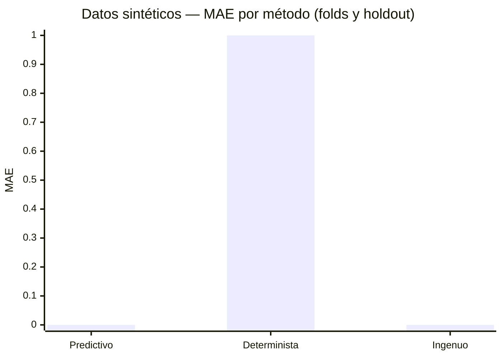
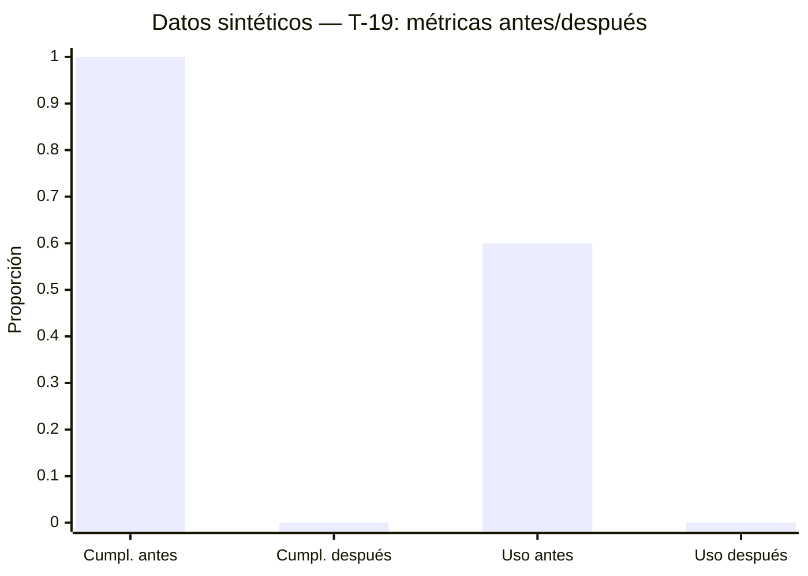

# Reporte técnico de evaluación — Plátano–Unibán

**Alcance:** T-04, T-06, T-10, T-14, T-18 y T-19

**Naturaleza de la evidencia:** pruebas y cálculos reproducibles del repositorio

## 1. Resumen y alcance

Este informe consolida la evidencia disponible en el repositorio para el inventario
de variables (T-04), la proyección determinista (T-06), la programación y transporte
(T-10), el modelo predictivo (T-14), el error absoluto de insumos (T-18) y el
escenario de cambio de ventana (T-19).

Se distinguen tres clases de evidencia:

1. **Diseño documentado:** contratos, decisiones, código y configuración indican
   estructuras o reglas previstas, pero no demuestran por sí mismos que los datos
   correspondientes existan en el histórico real.
2. **Pruebas y cálculos sintéticos:** entradas escritas en fixtures o pruebas se
   ejecutan contra el código y algunos resultados se calculan manualmente en las
   propias pruebas. Sirven para comprobar comportamiento técnico, no desempeño
   agronómico u operativo real.
3. **Validación histórica real:** evaluación con datos históricos autorizados de
   Unibán, tras verificar su origen, cobertura, unidades y claves.

**El repositorio no contiene evidencia de una evaluación con datos históricos reales
autorizados de Unibán.** Los números y gráficos de este informe que proceden de
fixtures son sintéticos; no son observaciones productivas ni estimaciones de
desempeño real.

**Actualización (D-019, octubre de 2026):** el riesgo declarado en `CONTEXT.md` §11 ya
se resolvió — ese acceso no llegó y no va a llegar. Esto deja de ser una brecha temporal
de evidencia y pasa a ser la condición definitiva de evaluación del proyecto: toda
métrica de este informe es sintética por decisión, no por falta de tiempo.

## 2. T-04 — Inventario de variables

La tabla resume `docs/inventario-variables.md`. “Pendiente” en verificación real
significa que no se contrastó con un extracto autorizado; no significa que la
variable esté ausente del histórico. Los tipos, unidades y estados contractuales
resumen lo documentado, no observaciones reales.

| Variable | Tipo documentado | Unidad documentada | Estado contractual/documental | Cobertura documentada | Verificación real |
|---|---|---|---|---|---|
| `parcela_id` | string (UUID) | No aplica | Requerido; formato cerrado en D-016 (identificador del sistema de origen, ya no `P-NNN`/D-007, superada) | Confirmado de punta a punta con Equipo 1 y Equipo 3 (ver `docs/inventario-variables.md`) | Confirmado |
| `fecha` de aforamiento | date | Fecha calendario | Requerido | Por aforamiento; serie histórica y rango pendientes | Pendiente |
| `area_ha` | float | hectáreas (`ha`) | Requerido | Por aforamiento; rango histórico pendiente | Pendiente |
| `num_plantas_estimado` | int | plantas | Requerido | Por aforamiento; frecuencia y rango pendientes | Pendiente |
| `calidad_confianza` | float, rango contractual 0–1 | Adimensional | Requerido | Por aforamiento; frecuencia y rango pendientes | Pendiente |
| `edad_racimo` o fecha de floración | No definido en el contrato actual | Semanas o fecha calendario, según alternativa | Ausente del contrato actual; propuesta futura | Pendiente | Pendiente |
| `acopio_id` | string | No aplica | Requerido en la operación | Ejemplo por registro; historial y frecuencia pendientes | Pendiente |
| `tiempo_acarreo_min` | int | minutos | Requerido en la operación | Por parcela según documentación; cobertura pendiente | Pendiente |
| `medio_acarreo` | enum (`cable_via`, `traccion_animal`, `otro`) | No aplica | Requerido en la operación | Por parcela según contrato; cobertura pendiente | Pendiente |
| `capacidad_medio_racimos` | int | racimos por viaje | Requerido en la operación | Por parcela según contrato; cobertura pendiente | Pendiente |
| `vehiculos[].capacidad_racimos` | int | racimos | Presente en la lista de vehículos del contrato | Disponibilidad por periodo indicada; periodos reales pendientes | Pendiente |
| `ventana_despacho.inicio` y `.fin` | timestamps | Fecha y hora; zona horaria no especificada | Requeridos en la operación | Ventana por periodo según contrato; serie y frecuencia reales pendientes | Pendiente |
| `inventario[].insumo` | string | No aplica | Presente en inventario del contrato | Por parcela en tabla contractual; cobertura pendiente | Pendiente |
| `inventario[].cantidad` / `cantidad_disponible` | Numérico; modelo `Numeric(10, 2)`, aplicación `float` | Unidad física no definida; confirmar por insumo | El ejemplo no especifica unidad ni periodo/marca temporal | El modelo guarda periodo, el ejemplo contractual no; cobertura y actualidad pendientes | Pendiente |
| `consumos[].insumo`, `.periodo`, `.cantidad` | `consumos[]` opcional; ejemplo con string, periodo y cantidad numérica | Unidad física no definida; confirmar por insumo | Opcional | Ejemplo con periodo; longitud del histórico y cobertura pendientes | Pendiente |
| Histórico de cosecha real por parcela/semana | Tipo y formato no especificados | No definida; volumen esperado por confirmar | No forma parte de una entrega confirmada | Pendiente | Pendiente |
| Estacionalidad (clima, precio) | Tipo y formato no especificados | No definida | No incluida en el contrato; no hay fuente responsable acordada | Pendiente | Pendiente |

**Lectura de T-04:** `docs/inventario-variables.md` declara T-04 pendiente de
verificación con datos reales. En particular, no se confirman disponibilidad,
unidades, cobertura, rangos, frecuencia ni patrones de valores ausentes. La edad
del racimo y el histórico de cosecha son brechas relevantes para T-14.

## 3. T-06 — Proyección determinista

La prueba `tests/casos/test_caso_02_proyeccion_determinista.py`,
`test_proyeccion_situacion_normal`, declara expresamente que sus entradas son
sintéticas y no históricas de Unibán.

| Entrada del fixture | Valor sintético |
|---|---:|
| Plantas (`sintetico_num_plantas`) | 1,850 |
| Área (`sintetico_area_ha`) | 2.4 ha |
| Confianza del aforamiento (`sintetico_calidad_confianza`) | 0.87 |
| Ciclo (`sintetico_ciclo_racimo_semanas`) | 10.5 semanas |
| Factor de pérdida (`sintetico_factor_perdida`) | 0.05 |
| Parcela / periodo | `P-018` / `2026-W38` |

La fórmula de `app/core/proyeccion/base.py` es:

```text
volumen = num_plantas × (1 / ciclo_racimo_semanas)
          × calidad_confianza × (1 - factor_perdida)
```

Aplicación según el cálculo de la prueba:

```text
1 / 10.5 = 0.0952380952...
1,850 × (1 / 10.5) × 0.87 × (1 - 0.05) = 145.621428...
redondeado a una decimal = 145.6 racimos
```

El test comprueba `145.6`, el método `determinista-v1` y la conservación de
parcela y periodo. Esto verifica el cálculo y su salida reproducible para el
fixture; **no mide error contra cosechas observadas**.

## 4. T-10 — Programación y transporte

`app/core/programacion/heuristica.py` produce un `PlanRecoleccion` con ítems que
incluyen parcela, fecha de corte, vehículo, orden, carga estimada, cumplimiento
de ventana y motivo. Las métricas disponibles son:

- `cumplimiento_ventana`: proporción de ítems cuyo campo `cumple_ventana` es
  verdadero; devuelve `0.0` para un plan vacío.
- `uso_capacidad(vehiculos)`: carga asignada dividida por la capacidad total
  disponible; no incluye ítems sin vehículo y devuelve `0.0` si no hay vehículos
  o la capacidad total es cero.

| Métrica o evidencia | Valor observado en prueba | Origen | Tipo de evidencia | Limitación |
|---|---:|---|---|---|
| Cumplimiento de ventana | 0.5 (1 de 2 ítems) | `test_caso_08_heuristica_programacion.py::test_cumplimiento_ventana_calcula_proporcion_y_maneja_plan_vacio` | Plan sintético construido directamente para la prueba | No es una medición de operación real |
| Cumplimiento de plan vacío | 0.0 | La misma prueba de cumplimiento | Sintético | Convención del código; no representa parcelas observadas |
| Uso de capacidad | 0.3 (60 / 200 racimos) | `test_uso_capacidad_usa_solo_carga_asignada_y_maneja_sin_vehiculos` | Plan sintético; V1 y V2 con 100 racimos de capacidad cada uno; solo 60 están asignados | Los 40 racimos del ítem no asignado se excluyen según la implementación |
| Sin vehículos / capacidad total cero | 0.0 / 0.0 | La misma prueba de uso de capacidad | Casos sintéticos | No indica desempeño de flota |
| Asignaciones y capacidad | P-001 → V1 (50), P-002 → V2 (60), P-003 → V1 (30); cargas 80/100 y 60/60 | `test_programar_acumula_carga_y_asigna_vehiculos_sin_exceder_capacidad` | Escenario sintético de programación | Comprueba factibilidad de ese escenario, no optimalidad |
| Fecha límite y orden | Prioridad por fecha límite; empate por `parcela_id` | `test_programar_prioriza_fecha_limite_y_desempata_por_parcela_id` | Valores sintéticos | Prueba una regla y entradas concretas |
| Ventana o capacidad no cumplidas | Ítem sin vehículo, `cumple_ventana=False` y motivo | `test_programar_marca_ventana_fisicamente_inalcanzable_como_no_cumplida` y `test_programar_marca_no_programada_la_parcela_que_no_cabe_en_ningun_vehiculo` | Escenarios sintéticos | No estima frecuencia de fallos reales |

Las pruebas de origen están en `tests/casos/test_caso_08_heuristica_programacion.py`.
T-07 también prueba casos de fecha límite en
`tests/casos/test_caso_01_fecha_limite.py` y
`tests/casos/test_caso_04_fecha_limite_bordes.py`.

D-002, vigente, establece una heurística constructiva y descarta prometer un
solucionador exacto. Por tanto, los tests respaldan las restricciones verificadas
en esos casos, no que el plan sea óptimo.

## 5. T-14 — Modelo predictivo

El fixture `cosechas_temporales_sinteticas` de
`tests/casos/test_caso_10_predictivo.py` crea **ocho periodos sintéticos**
(`2026-W01` a `2026-W08`) y dos parcelas (`P-001`, `P-002`) por periodo. El
objetivo sintético se define como `3 × valor + 2`. No son observaciones de Unibán.

La prueba `test_evaluar_temporal_integrada_compara_tres_metodos_por_clave_sintetica`
solicita dos folds y un holdout final de dos periodos. En cada fold y en el
holdout compara los métodos en las mismas claves disponibles:

| Bloque de evaluación sintético | Candidatas | Incluidas en comparación | Excluidas | MAE predictivo | MAE determinista | MAE ingenuo |
|---|---:|---:|---:|---:|---:|---:|
| Fold 1 | 4 | 2 | 2 | 0.0 | 1.0 | 0.0 |
| Fold 2 | 4 | 2 | 2 | 0.0 | 1.0 | 0.0 |
| Holdout (`2026-W07`, `2026-W08`) | 4 | 2 | 2 | 0.0 | 1.0 | 0.0 |

Estos valores son los asserts de la prueba, no resultados generalizables. En
cada bloque se evalúan dos parcelas en dos periodos candidatos; se incluyen dos
observaciones y se excluyen dos. La prueba comprueba que las exclusiones de la
comparación normal corresponden al segundo periodo de evaluación y que en ellas
falta la predicción ingenua. Un caso adicional
(`test_evaluar_temporal_integrada_reporta_predicciones_deterministas_ausentes`)
comprueba el reporte de una predicción determinista ausente: para su fold hay
4 candidatas, 1 incluida y 3 excluidas; los motivos identifican el método sin
predicción por clave.

La prueba `test_evaluar_temporal_integrada_registra_historial_fijo_sin_fuga`
comprueba con el fixture que los historiales utilizados para generar predicciones
no incorporan los periodos de validación ni los del holdout correspondiente.
`test_evaluar_temporal_integrada_mantiene_predicciones_y_recalcula_metricas`
comprueba además que modificar objetivos de validación/holdout no modifica las
predicciones ya generadas para esos bloques, mientras las métricas sí responden
a los valores objetivo cambiados.

La tabla y la gráfica siguientes reproducen solamente los MAE que la prueba
aserta. Los resultados sintéticos no son métricas de desempeño real y no
justifican adoptar el predictivo. D-003, vigente, condiciona su adopción a
superar de forma medible tanto al determinista como a la línea base ingenua en
un conjunto de prueba temporal. Esa evaluación real está pendiente.



## 6. T-18 — Error absoluto de insumos

D-015 está vigente. Define la comparación por insumo, parcela y periodo y
aprueba:

```text
error_absoluto = |cantidad_requerida_estimada - consumo_observado|
```

Solo se calcula cuando hay emparejamiento inequívoco, periodo del mismo
intervalo y unidades compatibles. No se hacen conversiones ni se suman errores
de unidades físicas diferentes. Un consumo cero es válido; un consumo ausente
no se convierte en cero. Los casos con claves incompletas, periodos no
emparejables, duplicados ambiguos o unidades incompatibles son no comparables.

| Caso sintético | Entrada comprobada | Resultado/estado | Origen | Limitación |
|---|---|---|---|---|
| Coincidencia exacta | Requerido 10, observado 7; mismas claves y `unidad_sintetica` | Error absoluto 3; evaluable | `test_error_absoluto_compara_claves_y_unidades_sinteticas_iguales` | Unidad ficticia de prueba, no unidad real |
| Consumo cero | Requerido 10, observado 0 | Error absoluto 10; evaluable | `test_error_absoluto_acepta_consumo_observado_cero_sintetico` | No representa consumo real |
| Consumo ausente | Cantidad observada `None` o sin registro | `consumo_ausente`, sin error numérico | `test_consumo_sintetico_ausente_no_se_reemplaza_por_cero` y `test_sin_registro_de_consumo_es_ausencia_real` | Comportamiento técnico sintético |
| Claves incompletas / periodo no emparejable | Parcela o periodo incompletos/inválidos, o semana distinta | No comparable, sin error numérico | `test_claves_incompletas_o_periodo_invalido_son_no_comparables`, `test_estimacion_con_periodo_invalido_reporta_consumo_potencial`, `test_estimacion_con_clave_incompleta_reporta_consumo_potencial`, `test_periodo_de_consumo_invalido_no_se_clasifica_como_ausente`, `test_periodo_sintetico_sin_coincidencia_es_no_comparable` | No define correspondencia temporal productiva |
| Duplicados | Varias estimaciones o consumos con la misma clave | Cada registro involucrado se reporta no comparable; sin emparejar arbitrariamente | `test_consumos_sinteticos_duplicados_no_se_emparejan_arbitrariamente`, `test_estimaciones_sinteticas_duplicadas_no_se_emparejan_arbitrariamente` y `test_consumo_con_periodo_invalido_no_se_asigna_a_estimaciones_potenciales` | No mide frecuencia de duplicados reales |
| Unidades incompatibles | Etiquetas sintéticas distintas | No comparable; error `None` | `test_unidades_sinteticas_incompatibles_son_no_comparables` | No se identifican conversiones |

La salida informa registros y conteos separados de evaluables, no evaluables por
consumo ausente y no comparables. El test
`test_no_agrega_errores_de_unidades_sinteticas_diferentes` verifica errores
individuales (3.0 y 4.0) para dos insumos; cada estimación y su consumo usan la
misma unidad sintética, pero las unidades de un insumo y otro son distintas. La
prueba comprueba ambos errores por registro, no una suma conjunta entre unidades.

La validación real sigue bloqueada según `TAREAS.md`: no están confirmadas las
unidades físicas por insumo; falta definir la correspondencia temporal entre
fecha de requerimiento y periodo de consumo; y no se ha identificado una fuente
integrada que garantice claves fiables. No se afirma validación con datos reales
autorizados de Unibán.

## 7. T-19 — Cambio de ventana de despacho

`tests/casos/test_caso_12_escenario_ventana_t19.py` usa una fecha fija en 2099,
una parcela sintética de 60 racimos, un vehículo de capacidad 100, acarreo de
60 minutos, empaque de 120 minutos y margen de seguridad de 30 minutos. Las
dos ejecuciones explícitas conservan entradas, periodo ISO y parámetros; solo
cambia la ventana.

La holgura requerida es `120 + 60 + 30 = 210` minutos.

| Resultado sintético | Ventana | Asignación | Fecha límite reportada | Motivo | Cumplimiento | Uso de capacidad |
|---|---|---|---|---|---:|---:|
| Antes | 06:00–12:00 | `P-SINTETICA` → V1; carga 60/100 | 08:30 | Ninguno (`None`) | 1.0 (1/1) | 0.6 (60/100) |
| Después | 09:30–12:00 | `P-SINTETICA` sin vehículo | Fin de ventana (12:00; se captura el caso inalcanzable) | Motivo contiene “no caben” | 0.0 (0/1) | 0.0 (0/100) |

La prueba verifica que las cargas asignadas no excedan la capacidad y que los
ítems programados tengan cumplimiento verdadero y fecha de corte dentro de la
ventana. La segunda llamada a `programar()` es una segunda ejecución explícita
del escenario sintético; **no es recálculo automático de un plan operativo**.
D-009 sigue como propuesta pendiente de validar con los equipos, no como una
decisión aprobada. Este resultado no representa una actualización operacional.



## 8. Consolidado de resultados

Los valores siguientes provienen de pruebas o cálculos sintéticos indicados en
la columna de origen. Las métricas que se muestran en distintas filas pueden
proceder de fixtures diferentes; los errores T-18 no se agregan entre unidades.

| Métrica | Valor | Origen | Tipo de evidencia | Limitación |
|---|---:|---|---|---|
| T-04: disponibilidad/cobertura verificada | Pendiente para cada variable | `docs/inventario-variables.md` | Diseño e inventario documental; sin extracto histórico | Pendiente no significa que la variable esté ausente |
| T-06: volumen proyectado | 145.6 racimos | `test_caso_02_proyeccion_determinista.py::test_proyeccion_situacion_normal` | Fixture sintético y cálculo manual | No compara con cosecha observada |
| T-10: cumplimiento de ventana | 0.5 | `test_caso_08_heuristica_programacion.py::test_cumplimiento_ventana_calcula_proporcion_y_maneja_plan_vacio` | Plan sintético (1 de 2 ítems) | No es una medición de operación real |
| T-10: uso de capacidad | 0.3 | `test_caso_08_heuristica_programacion.py::test_uso_capacidad_usa_solo_carga_asignada_y_maneja_sin_vehiculos` | Plan sintético (60/200 racimos) | Fixture distinto del caso de cumplimiento |
| T-14: MAE predictivo / determinista / ingenuo | 0.0 / 1.0 / 0.0 en cada fold y holdout | `test_caso_10_predictivo.py::test_evaluar_temporal_integrada_compara_tres_metodos_por_clave_sintetica` | Fixture sintético; 2 observaciones comparables por bloque | No es desempeño real ni justifica adopción |
| T-18: error absoluto, observado 7 | 3 `unidad_sintetica` | `test_caso_11_metricas_error_insumos.py::test_error_absoluto_compara_claves_y_unidades_sinteticas_iguales` | Registro sintético evaluable | La unidad no representa una unidad física confirmada |
| T-18: error absoluto, observado 0 | 10 `unidad_sintetica` | `test_caso_11_metricas_error_insumos.py::test_error_absoluto_acepta_consumo_observado_cero_sintetico` | Registro sintético evaluable | No representa consumo real; no se agrega con otras unidades |
| T-18: consumo ausente / no comparable | Sin error numérico; estado separado | Pruebas de consumo ausente, claves incompletas, periodos, duplicados y unidades incompatibles | Casos sintéticos de clasificación | No valida la integración ni los datos productivos |
| T-19: cumplimiento antes / después | 1.0 / 0.0 | `test_caso_12_escenario_ventana_t19.py::test_t19_compara_planes_sinteticos_antes_y_despues_de_mover_ventana` | Dos ejecuciones explícitas con la misma parcela y distinto horario | No es recálculo automático ni resultado operacional |
| T-19: uso de capacidad antes / después | 0.6 / 0.0 | La misma prueba T-19 | Escenario sintético (60/100 antes; 0/100 después) | No mide utilización de flota real |

## 9. Decisiones, limitaciones y reproducibilidad

| Decisión | Estado literal en `DECISIONES.md` | Implicación para este informe |
|---|---|---|
| D-002 — heurística constructiva, no solucionador exacto | Vigente | Reportar factibilidad y métricas; no afirmar optimalidad |
| D-003 — adoptar predictivo solo si supera al modelo base | Vigente | Los MAE sintéticos no deciden adopción; se requiere evaluación temporal real frente a ambos métodos |
| D-006 — declarar escenarios sintéticos | Vigente | Etiquetar fixtures y gráficas como “Datos sintéticos” |
| D-009 — ventanas con mínimo 48 h de anticipación | Propuesta — pendiente de validar con equipos 1 y 3 | No presentar como regla aprobada ni describir T-19 como actualización automática |
| D-015 — error de estimación de insumos | Vigente | Aplicar error absoluto y límites de emparejamiento/unidades; no agregar unidades físicas diferentes |
| D-016 — `parcela_id` es el identificador del sistema de origen (UUID), reemplaza D-007 | Vigente | El identificador de parcela ya no es una brecha de T-04; queda confirmado en vez de pendiente |
| D-019 — riesgo de histórico real materializado: no llegó | Vigente | T-04 y T-14 dejan de describirse como "pendientes de verificación" y pasan a "evaluados exclusivamente con sintéticos, por decisión" |

**Limitaciones por tarea** (ya no son brechas temporales de evidencia para T-04/T-14;
son la condición definitiva de evaluación tras D-019):

- **T-04:** no hubo extracto histórico real autorizado — por decisión (D-019), no por
  falta de tiempo. Disponibilidad, tipos, unidades y cobertura reales nunca se
  verificaron y no se van a verificar dentro de este proyecto.
- **T-06:** la prueba de 145.6 solo valida la fórmula con aforamiento sintético;
  no se evaluó frente a cosecha observada, y no se evaluará (D-019).
- **T-14:** no hubo datos históricos reales ni evaluación productiva — por decisión,
  no por brecha pendiente. No se ha demostrado superioridad del predictivo; su
  adopción sigue sin cumplir D-003 y así se queda (no hay evaluación real programada).
  Las métricas comparativas se devuelven en memoria; no se encontró almacenamiento
  durable implementado ni el repositorio define un requisito durable para “métricas
  registradas”.
- **T-18:** la validación real requeriría confirmar unidades, claves, cobertura y
  correspondencia temporal con datos reales que no van a llegar (D-019). La evidencia
  de este informe es, y seguirá siendo, sintética.
- **T-19:** se probó un contraste sintético de dos planes explícitos; D-009
  permanece pendiente de validación con los equipos 1 y 3 y no se probó
  automatización operacional.

Las pruebas de origen se encuentran en `tests/casos/` y las implementaciones
citadas en `app/core/`. Los valores incluidos aquí se refieren a sus fixtures
identificados, no a un conjunto común de datos históricos. La sección T-14
expone métricas del mismo fixture de comparación de tres métodos; las métricas
de T-10 provienen de pruebas sintéticas distintas entre sí. No se realizó
agregación de errores de insumos entre unidades diferentes.
