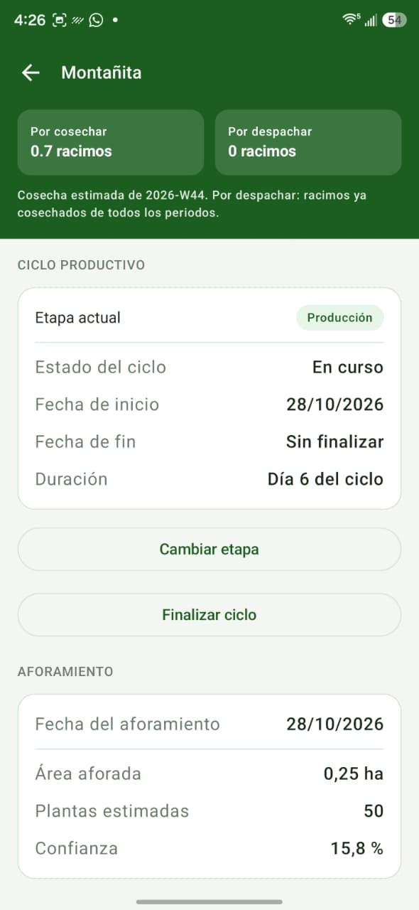
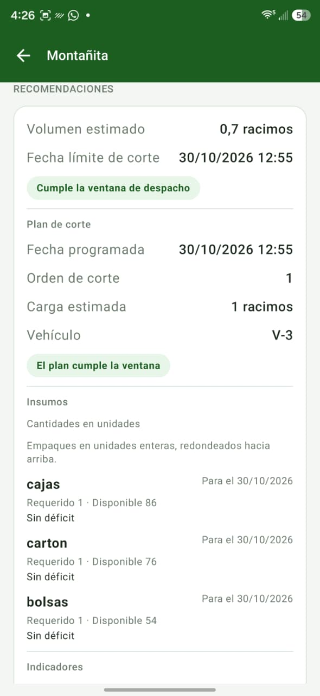

# Evidencias de seguimiento — Equipo 2

Proyecto UNIBÁN · Logística y planificación de cosecha · Verificado contra el servicio desplegado el 12 de noviembre de 2026.

> Este documento reemplaza el índice enviado el 5 de noviembre. Aquel índice enlazaba la rama develop-jose, que no tenía las pruebas de integración ni la relación con los objetivos, y citaba valores de error (18.4 %, 7.2 % y 8.1 %) tomados de una versión preliminar de la interfaz que no salían del código. Aquí todo apunta a la rama main y las cifras se pueden reproducir.

## Cómo verificarlo en cinco minutos

1. Abrir [Swagger (documentación interactiva)](https://platano-logistica-api.onrender.com/docs). La primera carga puede tardar hasta un minuto, porque el servicio gratuito se suspende sin uso.
2. En Swagger, abrir POST /api/v1/recomendar, pulsar Try it out y Execute con el ejemplo: devuelve la recomendación completa.
3. Abrir [Evaluación de modelos en vivo](https://platano-logistica-api.onrender.com/api/v1/modelos/evaluacion) en el navegador: devuelve las métricas del modelo predictivo frente al determinista y la línea base.
4. En el [Repositorio (rama main)](https://github.com/Uniban-Int1/CodeBack/tree/main), ejecutar pytest: 203 pruebas pasan.

## Requerimientos del profesor y evidencia comprobable

| # | Requerimiento | Estado | Resultado comprobable | Cómo verificarlo |
|---|---|---|---|---|
| 1 | Modelo determinista funcional y validado para cajas, cartón, bolsas y demás insumos | Cumplido | En producción. Caso verificado a mano: 1850 plantas con confianza 0.87 dan 145.6 racimos, corte a las 12:55 y 123.76 cajas requeridas (déficit 43.76 con 80 en inventario). | Swagger, POST /recomendar; tests/casos 02, 03, 06 y 07. [Swagger (documentación interactiva)](https://platano-logistica-api.onrender.com/docs) · [docs/pruebas-integracion.md](https://github.com/Uniban-Int1/CodeBack/blob/main/docs/pruebas-integracion.md) |
| 2 | Modelo predictivo evaluado, con métricas de error y comparación frente al modelo base | Cumplido con datos sintéticos | MAE en la semana reservada: predictivo 6.80, determinista 10.08, línea base ingenua 6.25 racimos por parcela y semana. El predictivo supera al determinista, pero no a la línea ingenua: por la regla D-003 se mantiene el determinista. | Abrir la evaluación en vivo o ejecutar python scripts/evaluar_modelos.py. [Evaluación de modelos en vivo](https://platano-logistica-api.onrender.com/api/v1/modelos/evaluacion) · [docs/reporte-evaluacion.md](https://github.com/Uniban-Int1/CodeBack/blob/main/docs/reporte-evaluacion.md) |
| 3 | Módulo funcional de apoyo a la programación de cosecha y despacho | Cumplido | Cinco parcelas de cuatro productores y dos vehículos: con la ventana a las 16:00 se programan 3 de 5 (uso de capacidad 67 %); al adelantar el cierre a las 10:00 cambia el orden y el uso sube a 82 %. | python scripts/demo_programacion.py y luego con 10:00; tests/casos 08 (13 pruebas). [docs/cumplimiento-objetivos.md](https://github.com/Uniban-Int1/CodeBack/blob/main/docs/cumplimiento-objetivos.md) |
| 4 | Procesar aforamiento, cosecha esperada, inventarios, consumos y ventanas de despacho | Cumplido | POST /recomendar recibe los cinco. Los consumos de los últimos 90 días vuelven resumidos por insumo. Si falta un dato obligatorio responde 422 con la lista de faltantes en lugar de inventar valores. | Swagger; tests/casos 13 y test_api_recomendacion. [Swagger (documentación interactiva)](https://platano-logistica-api.onrender.com/docs) · [docs/contrato-integracion.md](https://github.com/Uniban-Int1/CodeBack/blob/main/docs/contrato-integracion.md) |
| 5 | Recomendaciones de abastecimiento con cantidades, déficit o excedente y fechas | Cumplido | Por cajas, cartón y bolsas: cantidad requerida, inventario, déficit, excedente y fecha en que se necesitan. | Respuesta de POST /recomendar. [Swagger (documentación interactiva)](https://platano-logistica-api.onrender.com/docs) |
| 6 | API funcional y documentada para recibir del Equipo 3 y devolver las recomendaciones | Cumplido | Desplegada en Render y en uso por el backend del Equipo 3. Contrato acordado por ambos equipos. | Swagger y contrato. [Swagger (documentación interactiva)](https://platano-logistica-api.onrender.com/docs) · [Contrato acordado con el Equipo 3](https://github.com/JuanSebastian05/uniban-app-suministros/blob/main/docs/contrato-equipo2.md) |
| 7 | Evidencia de pruebas, coherencia y trazabilidad | Cumplido | 203 pruebas automáticas, con el cálculo a mano en cada caso. Toda respuesta incluye version_metodo. | pytest; docs/pruebas-integracion.md. [tests/](https://github.com/Uniban-Int1/CodeBack/tree/main/tests) · [docs/pruebas-integracion.md](https://github.com/Uniban-Int1/CodeBack/blob/main/docs/pruebas-integracion.md) |
| 8 | Demostración: caso conocido, cambio de variables, métricas y visualización en el componente del Equipo 3 | Cumplido | La app Android del Equipo 3 muestra la recomendación que calcula nuestro servicio, con los mismos valores del cálculo a mano (ver la sección de capturas). | Capturas del Equipo 3 en este documento; docs/pruebas-integracion.md, prueba P3. [docs/pruebas-integracion.md](https://github.com/Uniban-Int1/CodeBack/blob/main/docs/pruebas-integracion.md) |
| 9 | Datos simulados claramente identificados | Cumplido | No hubo acceso a registros históricos de Unibán (D-019). Todas las fuentes sintéticas están registradas. | data/README.md y DECISIONES.md. [data/README.md](https://github.com/Uniban-Int1/CodeBack/blob/main/data/README.md) · [DECISIONES.md](https://github.com/Uniban-Int1/CodeBack/blob/main/DECISIONES.md) |

## Pruebas de integración con el Equipo 3 (28/10/2026)

| Prueba | Resultado esperado | Resultado obtenido |
|---|---|---|
| P1 · Ambos servicios responden | 200 | Correcto. Equipo 3 /health y Equipo 2 /salud responden 200 |
| P2 · Solicitud completa con el formato del Equipo 3 | Recomendación con los valores del cálculo a mano | Correcto: 145.6 racimos, corte 12:55, déficits 96.67 / 76.67 / 141.2 |
| P3 · Recomendación visible en la app del Equipo 3 | Valores iguales al cálculo a mano | Correcto (ver capturas) |
| P4 · Solicitud sin ventana de despacho | 422 que nombra el campo | Correcto |
| P5 · Aforamiento con confianza nula | 422 que nombra el campo | Daba 500; corregido, ahora 422 |
| P6 · Consultas que leen la base de datos | 404 si no hay plan | Daban 500 (tablas sin crear); corregido |
| P7 · Ventana de despacho ya pasada | No se recomienda sobre una hora pasada | Corregido: el Equipo 3 calcula la ventana desde la fecha de consulta |
| P8 · Simulador de la app del Equipo 2 contra el servicio desplegado | Respuesta en vivo | Correcto |
| P9 · Llamada sin cabecera de autenticación | Aceptada (autenticación apagada, D-018) | Correcto |

## La recomendación en la app del Equipo 3

Verificación a mano: 50 × (1/10.5) × 0.158 × (1 − 0.05) = 0.7 racimos; hora límite 16:00 − 3 h 05 min = 12:55; vehículo V-3. Son las fórmulas y los parámetros del Equipo 2. La app del Equipo 3 redondea las unidades de empaque hacia arriba. Fuente: [evidencias del Equipo 3](https://github.com/JuanSebastian05/uniban-app-suministros/tree/main/docs/validacion/evidencias).

## Límites conocidos

- Todos los datos son sintéticos: el predictivo no se evaluó con cosecha real.
- La ventana de despacho real no la tiene ningún equipo; se usa una de demostración.
- El servicio integrado evalúa una parcela por solicitud; la consolidación de varios productores se demuestra con el script.
- La proyección no usa la edad del racimo, porque el Equipo 1 no la entrega.
- Los coeficientes de consumo no están calibrados con datos de Unibán.

## Documentos

- [docs/pruebas-integracion.md](https://github.com/Uniban-Int1/CodeBack/blob/main/docs/pruebas-integracion.md)
- [docs/cumplimiento-objetivos.md](https://github.com/Uniban-Int1/CodeBack/blob/main/docs/cumplimiento-objetivos.md)
- [docs/arquitectura.md](https://github.com/Uniban-Int1/CodeBack/blob/main/docs/arquitectura.md)
- [Arquitectura (versión visual)](https://claude.ai/artifact/A2zTfZnMfwJXo82vvJxGjJ)
- [docs/reporte-evaluacion.md](https://github.com/Uniban-Int1/CodeBack/blob/main/docs/reporte-evaluacion.md)
- [Contrato acordado con el Equipo 3](https://github.com/JuanSebastian05/uniban-app-suministros/blob/main/docs/contrato-equipo2.md)
- [docs/contrato-integracion.md](https://github.com/Uniban-Int1/CodeBack/blob/main/docs/contrato-integracion.md)
- [docs/guia-backend-equipo2.pdf](https://github.com/Uniban-Int1/CodeBack/blob/main/docs/guia-backend-equipo2.pdf)
- [DECISIONES.md](https://github.com/Uniban-Int1/CodeBack/blob/main/DECISIONES.md)
- [data/README.md](https://github.com/Uniban-Int1/CodeBack/blob/main/data/README.md)
